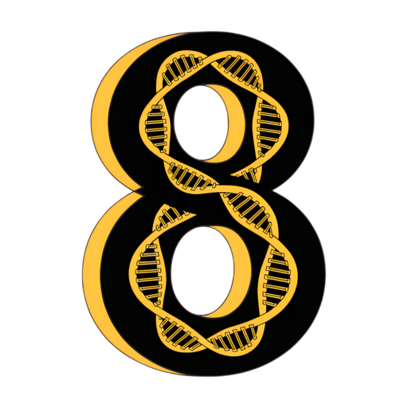
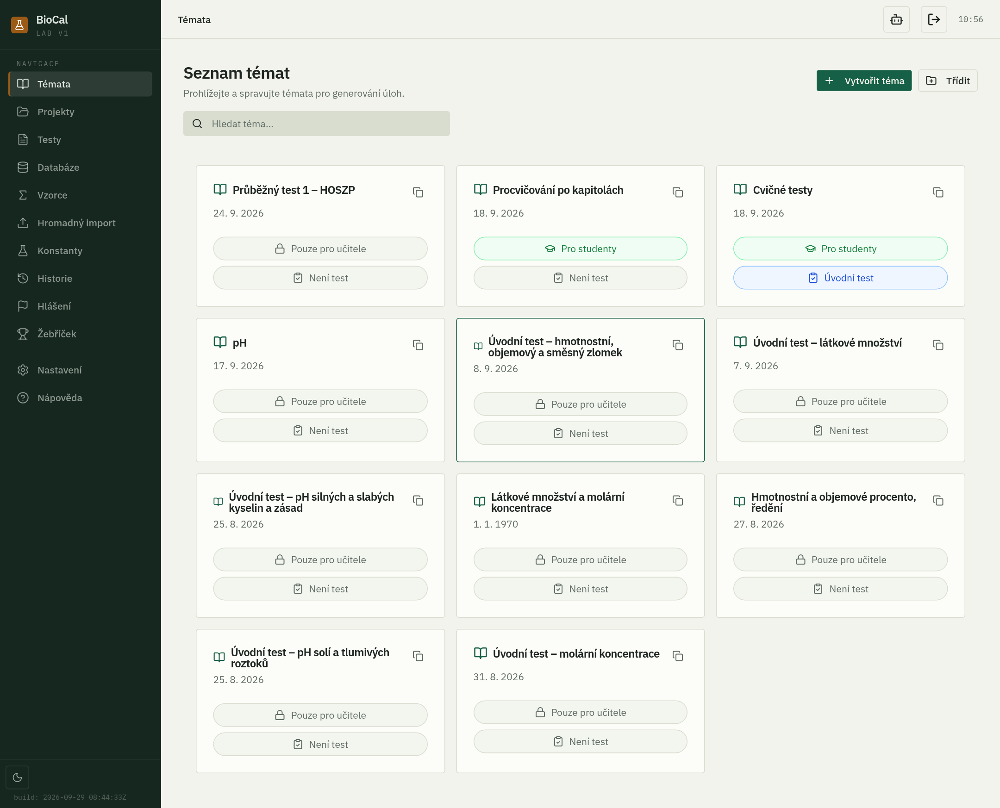
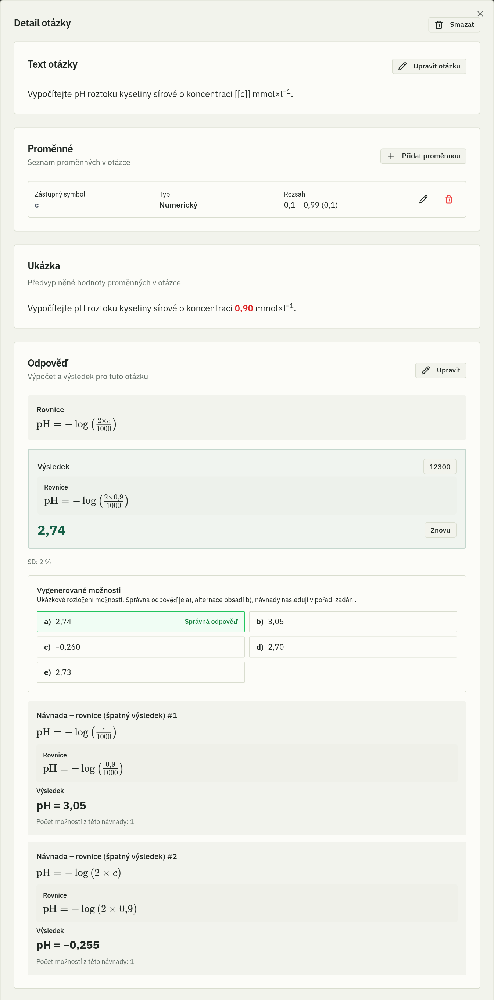
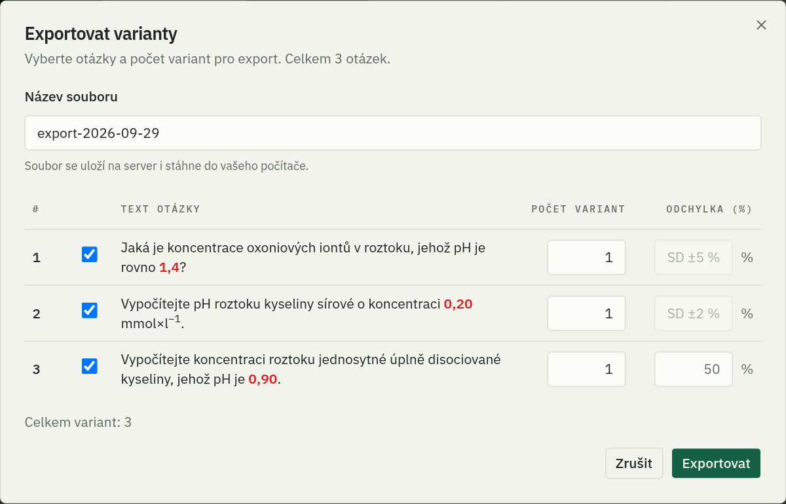
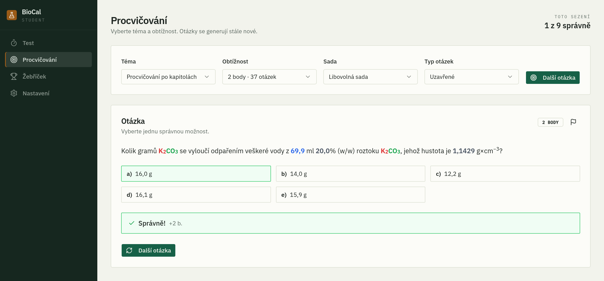
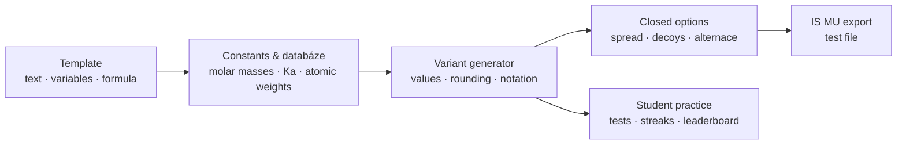
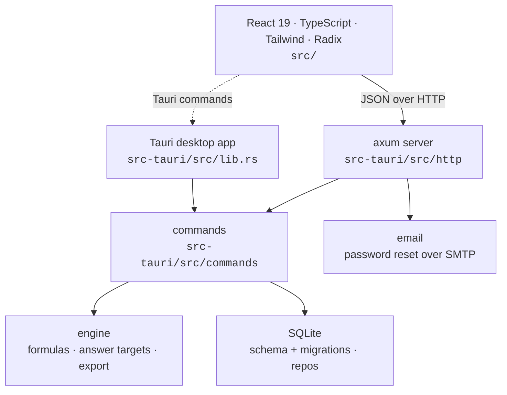

<div align="center">



# BioCal

**A generator of variable biochemistry calculation problems: every student gets their own numbers.**

[](https://biocal.ubch.sci.muni.cz/)

[](src-tauri)
[](src-tauri/src/db)
[](src)
[](src)
[](tailwind.config.ts)
[](vite.config.ts)
[](src-tauri)
[](LICENSE)

[**Features**](#features) · [**How it works**](#how-it-works) · [**Architecture**](#architecture) · [**Development**](#development) · [**Deployment**](#deployment)

<br />

<picture>
  <source media="(prefers-color-scheme: dark)" srcset="docs/images/topics-dark.png" />
  
</picture>

</div>

<br />

BioCal turns a biochemistry calculation into a **template**: question text with variables, a formula for the answer, and the constants it needs. From one template it generates as many **variants** as you want, each with its own values and a correctly rounded result. Teachers export them as tests for the **IS MU** university information system; students practise on them in the browser, with timed tests, streak runs and a leaderboard. The interface is in Czech.

<table>
  <tr>
    <td width="33%" valign="top">
      <h3>One template, many tasks</h3>
      Variables with ranges, significant digits and notation, a formula for each answer, and every variant computed and rounded for you.
    </td>
    <td width="33%" valign="top">
      <h3>Believable wrong answers</h3>
      Closed questions get distractors spread around the result, teacher-written decoys for typical mistakes, and a second correct option when a task allows one.
    </td>
    <td width="33%" valign="top">
      <h3>Straight into IS MU</h3>
      Exports in the IS MU test format, with Czech decimal commas, a real × and minus sign, units in super/subscript, and e-notation where IS MU needs it.
    </td>
  </tr>
  <tr>
    <td valign="top">
      <h3>Constants built in</h3>
      Physical constants, atomic weights and a database of molar masses and paired constants, all usable in any formula.
    </td>
    <td valign="top">
      <h3>Practice for students</h3>
      Topic practice, an úvodní and a průběžný timed test, Učeň and Mistr streak runs, reviewed results and a leaderboard.
    </td>
    <td valign="top">
      <h3>Web and desktop</h3>
      One Rust core runs as a multi-user web server with teacher and student accounts, or as a single-user Tauri desktop app.
    </td>
  </tr>
</table>

---

## Features

### Write templates

<table>
  <tr>
    <td width="45%" valign="top">
      <picture>
        <source media="(prefers-color-scheme: dark)" srcset="docs/images/question-dark.png" />
        
      </picture>
    </td>
    <td valign="top">

- **Topics** (*témata*) hold the questions, organised into named **groups**. A topic can be marked as visible to students.
- **Question templates**: write the question text with variables such as `[[X]]`, then give each variable a range, its **significant digits** and a **notation** (automatic, scientific or plain).
- **Formulas** compute the answer. A question can have **several answers**, each with its own unit, and results can be clipped to a min/max range.
- **Comparison constraints** between variables keep generated values chemically sensible.
- **Constants** (*konstanty*), **atomic weights** and the **databáze** of molar masses and paired constants (e.g. an acid with its Ka) can be used in any formula and question.
- Units and chemical formulas are written with `^` and `_` and shown as real super- and subscripts; equations render with KaTeX.
- **Bulk import** creates many questions at once from a prepared file.

    </td>
  </tr>
</table>

### Generate and export

<picture>
  <source media="(prefers-color-scheme: dark)" srcset="docs/images/export-dark.png" />
  
</picture>

- **Sets** (*sady*) collect questions for a test. Reorder them, merge sets by drag and drop, rename them and choose their mode.
- **Variant generator**: as many variants of each question as you need, each with fresh values and a correctly rounded result.
- **Closed questions**:
  - options spread around the correct result, with a per-question answer tolerance (SD);
  - **decoys** (*návnady*): the results of equations for typical mistakes, each given its own option slot;
  - **alternace**: a second correct option.
- **IS MU export**: the test file IS MU imports, with Czech number formatting, per-question deviation percentages, and e-notation for values IS MU can't take as plain decimals. Rename an export before downloading it; every export is kept in the **history**.
- **Preview** every generated question with its options and decoy results before exporting.

### Practise and test

<picture>
  <source media="(prefers-color-scheme: dark)" srcset="docs/images/practice-dark.png" />
  
</picture>

- **Practice**: students pick a topic and solve generated questions, open or multiple choice, with instant feedback.
- **Tests**:
  - **Úvodní** and **průběžný** tests: 12 questions under a 50-minute timer;
  - **Učeň** and **Mistr**: streak runs, answering correctly for as long as you can.
- **Results** are reviewed question by question, and a **leaderboard** shows how students compare.
- **Report a question**: students flag a question they think is wrong, and it lands in the teachers' **hlášení** queue with a badge in the sidebar.

### Accounts

- **Teacher** and **student** roles on the web server. Students register with an invite code; email is optional and only used for self-service password reset.
- Passwords are hashed with **Argon2**; sessions use cookies; reset emails go out over SMTP (STARTTLS).

---

## How it works



---

## Architecture

The core is a Rust crate in [`src-tauri/`](src-tauri): the formula engine, generator, export writer and SQLite database. It runs two ways: inside the **Tauri** desktop app, or as the standalone **`biochemcalc-server`** binary, an **axum** HTTP server with accounts that also serves the built frontend.



| Path | Role |
|---|---|
| [`src-tauri/src/engine`](src-tauri/src/engine) | Formula evaluation, multi-answer targets and the IS MU export writer |
| [`src-tauri/src/db`](src-tauri/src/db) | SQLite schema with versioned migrations, and a repository per entity |
| [`src-tauri/src/commands`](src-tauri/src/commands) | The operations both front ends call: topics, templates, sets, generation, auth |
| [`src-tauri/src/http`](src-tauri/src/http) | axum routes, session-cookie auth and teacher/student role gating |
| [`src-tauri/src/bin`](src-tauri/src/bin) | `biochemcalc-server` and import tools |
| [`src`](src) | React app: teacher pages, the student shell, Czech strings in [`src/i18n/cs.ts`](src/i18n/cs.ts) |

<details>
<summary><b>Repository layout</b></summary>

```
biochemcalc/
├── src/               React + TypeScript frontend (pages, components, stores, i18n)
├── src-tauri/         Rust core: engine, db, commands, http server, Tauri app
├── design-system/     design system reference
├── deploy/            server deployment files
├── scripts/           local dev against a snapshot, DB pull
├── public/            logo and icons
└── docs/images/       README screenshots
```

</details>

The look is a "benchtop lab" design system: IBM Plex type, porcelain and forest-green palettes for light and dark mode, hairline borders and no decorative motion ([`DESIGN.md`](DESIGN.md)).

---

## Development

<details open>
<summary><b>Prerequisites</b></summary>

| Tool | Why |
|---|---|
| [Rust](https://rustup.rs/) (stable) | the core, the server and the desktop app |
| [Node.js](https://nodejs.org/) 20.19+ | the frontend (Vite 7) |
| [Tauri prerequisites](https://tauri.app/start/prerequisites/) *(desktop only)* | system libraries for the native window |

</details>

```bash
npm install

npm run tauri dev    # desktop app with hot reload
npm run dev:local    # web server on :8080 + Vite on :1420, on a local copy of the question data (npm run db:pull)
```

```bash
npm test             # Vitest
npm run check        # Biome lint + format check
npm run build        # type-check + production build
cargo test --manifest-path src-tauri/Cargo.toml
```

---

## Deployment

The web app runs on a VM as `biochemcalc-server` behind nginx, with a live SQLite database of real teacher accounts, questions and datasets. [`DEPLOY.md`](DEPLOY.md) is the procedure: verify the build locally, **back up the database and the current binary**, pull and build on the VM, restart, and check that nothing was lost.

---

## License

Copyright (C) 2026 Vojtech Rejtar.

Biocal is licensed under the [GNU Affero General Public License v3.0 or later](LICENSE) (AGPL-3.0-or-later). If you modify it and let others use it, including over a network, you must publish your modified source under the same license and keep the original copyright and attribution notices.

<div align="center">
<br />
<sub>Made for biochemistry students by <b>Vojtěch Rejtar</b> · <a href="https://biocal.ubch.sci.muni.cz/">biocal.ubch.sci.muni.cz</a></sub>
</div>
